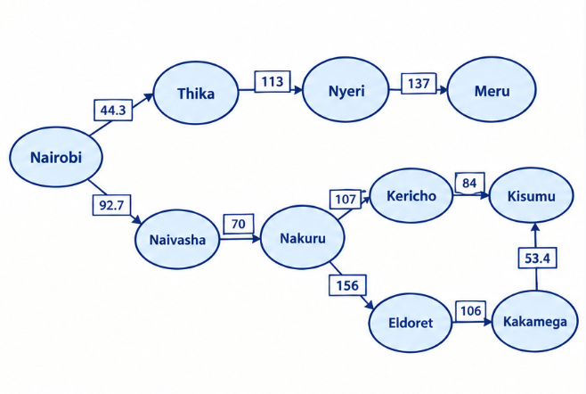
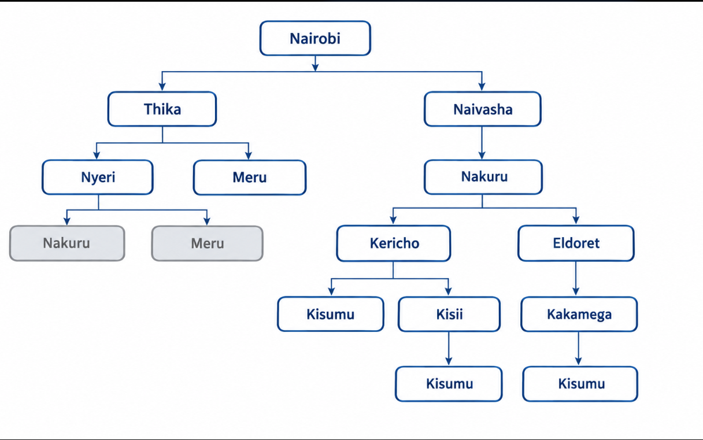

1. PEAS framework 

Performance measure - Reach Kisumu from Nairobi using the shortest total road distance, while maintaining safety, obeying traffic rules, avoiding collisions and minimizing fuel consumption. 

Environment - Kenya's highway network, including roads, towns and cities in Nairobi, Central Highlands, Rift Valley and Lake Victoria Basin, together with other vehicles, pedestrians, road conditions and traffic. 

Actuators - Steering, accelerator, brakes, gear control, indicators and other vehicle controls used to follow the selected route safely. 

Sensors - GPS, cameras, radar, wheel-speed sensors and navigation/ traffic data used to determine the trailer's location and detect road conditions and obstacles. 

 

Environment properties 

Partially observable. The trailer can use GPS and sensors to observe its surroundings, but cannot know every hidden hazard or future traffic event. 

Stochastic. Traffic, weather, road incidents and the actions of other road users make outcomes uncertain. 

Sequential. Each driving action affects the trailer's location and the options available for subsequent actions. 

Dynamic. Traffic, pedestrians, road conditions and obstacles can change while the trailer is travelling. 

Continuous. Speed, position and steering angle are continuous. The route level problem can be abstracted as discrete. 

 

 
 

2. Directed Graph 

Distance in Kms 

Drawn on canva 

 

Used canva 

 

3. 

Nairobi – Thika – Nyeri – Meru  = 294.3 kms (goal not reached) 

Nairobi – Naivasha – Nakuru – Kericho – Kisumu =354.2 kms ( Most optimum) 

Nairobi – Naivasha – Nakuru – Eldoret – Kakamega – Kisumu = 478.6 kms 

   
